<!--
  ============================================================
   THE DEV-VERSE  ·  Profile README for Ashish Chandra Acharjee
   All animated art lives in /assets (self-hosted SVG, no JavaScript).
   Two GitHub Actions fill in the 3D contribution graph.
  ============================================================
-->


 

  


<!-- ===================== ISSUE 01 · ORIGIN STORY ===================== -->

I'm **Ashish Chandra Acharjee**, a B.Tech Information Technology student at **Guru Nanak Institute of Technology, Kolkata**. I learn by building: take an idea, break it into parts, prototype it, ship it, then figure out what I'd do better next time.

So far that loop has produced an emergency-response platform, a healthcare assistant, a food-rescue network and an e-commerce app. Different universes, same habit.

<table>
<tr>
<td width="60%" valign="middle">


</td>
<td width="40%" align="center" valign="middle">


</td>
</tr>
</table>

<table>
<tr>
<td width="50%" valign="top">

**⚡ POWERS**

- 💻 Python, C, C++, Java, JavaScript, TypeScript
- 🌐 Frontend and backend development
- 🤖 AI/ML and data-driven applications
- 🔐 Document security and cryptography (SigilChain)

</td>
<td width="50%" valign="top">

**🎯 CURRENT MISSIONS**

- 🔭 Exploring AI/ML and data-driven apps
- 🏗️ Building projects that solve real problems
- 🏆 Chasing the next hackathon
- 🤝 Open to interesting projects and opportunities

</td>
</tr>
</table>

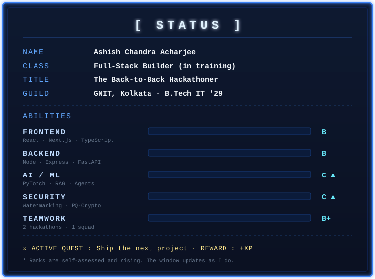

<!-- ===================== ISSUE 02 · UTILITY BELT ===================== -->



Everything in my stack, spinning in 3D. Find your favourite.

  


Every gadget on the belt is a skill. Watch them light up one by one.

  

<table>
<tr>
<td align="right" valign="middle"><b>⚔️ WEAPONS OF CHOICE</b> Languages</td>
<td align="left" valign="middle"></td>
</tr>
<tr>
<td align="right" valign="middle"><b>🕸️ WEB-SLINGERS</b> Frontend</td>
<td align="left" valign="middle"></td>
</tr>
<tr>
<td align="right" valign="middle"><b>🏛️ THE BATCAVE</b> Backend and databases</td>
<td align="left" valign="middle"></td>
</tr>
<tr>
<td align="right" valign="middle"><b>🧠 NEURAL NET</b> AI, ML and data</td>
<td align="left" valign="middle">  </td>
</tr>
<tr>
<td align="right" valign="middle"><b>🧰 GADGETS</b> Tools and platforms</td>
<td align="left" valign="middle"> </td>
</tr>
</table>

<!-- ===================== ISSUE 03 · CASE FILES ===================== -->


Every card is clickable. Open the live demo or crack open the source.

<table>
<tr>
<td width="50%" align="center" valign="top">

<a href="https://rakshalink-theta.vercel.app/"></a>
 

</td>
<td width="50%" align="center" valign="top">

<a href="https://food-bridge-indol.vercel.app/"></a>
 

</td>
</tr>
<tr>
<td width="50%" align="center" valign="top">

<a href="https://ipsakti-sahayak-delta.vercel.app/"></a>
 

</td>
<td width="50%" align="center" valign="top">

<a href="https://ai-doctor-assistance-s2ac.vercel.app/"></a>
 

</td>
</tr>
<tr>
<td width="50%" align="center" valign="top">

<a href="https://hackinverse-s1.devfolio.co/"></a>
 

</td>
<td width="50%" align="center" valign="top">

<a href="https://github.com/ashishacharjee/Velvetry-ECommerce-Website"></a>
 

</td>
</tr>
</table>

<!-- TODO: add a SigilChain repository badge in the case-file 005 cell once the repo is public -->

📸 <b>Click to peek at RakshaLink's live dashboard</b>

 

 

**🎲 SIDE QUESTS**

<table>
<tr><th>Quest</th><th>Loot</th></tr>
<tr><td>Personal Portfolio</td><td>My website and project showcase</td></tr>
<tr><td>Library Management</td><td>Books, members and borrowing</td></tr>
<tr><td>Food Ordering System</td><td>Terminal-based ordering and billing</td></tr>
<tr><td>Hangman Game</td><td>Python take on the classic</td></tr>
</table>

<!-- ===================== ISSUE 04 · BOSS BATTLES ===================== -->


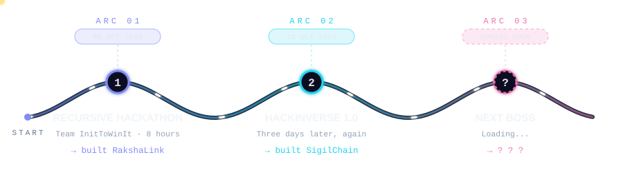

<table>
<tr>
<td width="22%" align="center" valign="middle">

  
<b>THE FIRST FIGHT</b>

</td>
<td width="78%" valign="top">

### Recursive Hackathon 2026
**Team InitToWinIt** · GNIT Kolkata ACM Student Chapter

My first hackathon. Eight hours to shape an idea, build the prototype, polish the flow and pitch it. We built **RakshaLink**, the road-emergency platform that connects people in distress with the right responders.

`Emergency Response` `Responder Workflow` `Crash Alerts` `Web Development`

</td>
</tr>
<tr>
<td width="22%" align="center" valign="middle">

  
<b>THE SEQUEL</b>

</td>
<td width="78%" valign="top">

### HackInverse 1.0
**Project: SigilChain** · *every leak leaves a fingerprint*

Three days later, another build. SigilChain tackles document-leak attribution: recipient-specific watermarking that helps trace a leaked copy back to the copy issued to one particular recipient, backed by cryptographic techniques for protecting authenticity and auditability.

`Python` `Document Security` `Watermarking` `Post-Quantum Cryptography`

</td>
</tr>
</table>

<!-- ===================== ISSUE 05 · ACHIEVEMENTS ===================== -->


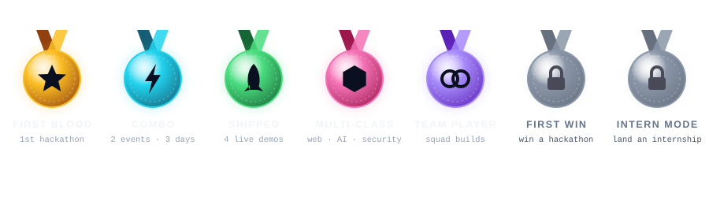

<table>
<tr>
<td width="55%" valign="top">

| | Achievement | Unlocked |
|:-:|:--|:--|
| 🩸 | **First Blood**: first hackathon, prototype built in 8 hours | 08 Oct 2026 |
| ⚡ | **Combo**: second hackathon only three days later | 11 Oct 2026 |
| 🚀 | **Shipped**: four projects with live demos | ongoing |
| 🧩 | **Multi-Class**: web, AI/ML and security in one portfolio | ongoing |
| 🤝 | **Team Player**: collaborative builds, two events | ongoing |

</td>
<td width="45%" valign="top">

**📜 QUEST LOG**

- [x] Build and ship a full-stack project
- [x] Join my first hackathon
- [x] Build an AI assistant with RAG
- [x] Prototype a document-security idea
- [ ] Win a hackathon 🏆
- [ ] Land an internship
- [ ] Merge a pull request into open source
- [ ] Build something real people use daily

</td>
</tr>
</table>

<!-- ===================== ISSUE 06 · THE MULTIVERSE ===================== -->


Click a world to see what it taught me about building software.

🦇 <b>Batman</b>: always have the right gadget ready

 

Preparation beats raw talent. I like having the right tool ready *before* the problem shows up, which is exactly why my utility belt exists and why RakshaLink is built around being ready before things go wrong. The signal goes up, the right responder shows up.

🕷️ <b>Spider-Man</b>: great power, great responsibility

 

Code ships to real people, so it deserves a proper review. And the Spider-Verse line stays with me: *anyone can wear the mask.* Nobody should be gatekept out of learning to build.

🟣 <b>Jujutsu Kaisen</b>: domain expansion, deep-work mode

 

Cursed energy is just focus under pressure. Gojo's Hollow Purple merges two opposing techniques into one, which is what full-stack work feels like: frontend and backend colliding into something that actually works. Headphones on, domain expanded.

🌊 <b>Demon Slayer</b>: total concentration, every day

 

You do not get strong in a day. You get strong by repeating the basics until they become automatic, like breathing. Total Concentration is just daily practice done with full attention, then shipping what you made.

🕵️ <b>Spy x Family</b>: a mixed team on one mission

 

A spy, an assassin and a telepath make a family that somehow works, because each brings a different skill. Hackathon squads run on the same energy: mixed strengths, one mission, one very good plan. Operation Strix, but with pull requests.

<!-- ===================== ISSUE 07 · WATCHTOWER ===================== -->

  

**🧊 3D CONTRIBUTION CITY**
 
My commit history as a 3D skyline. Updated automatically every day.
 

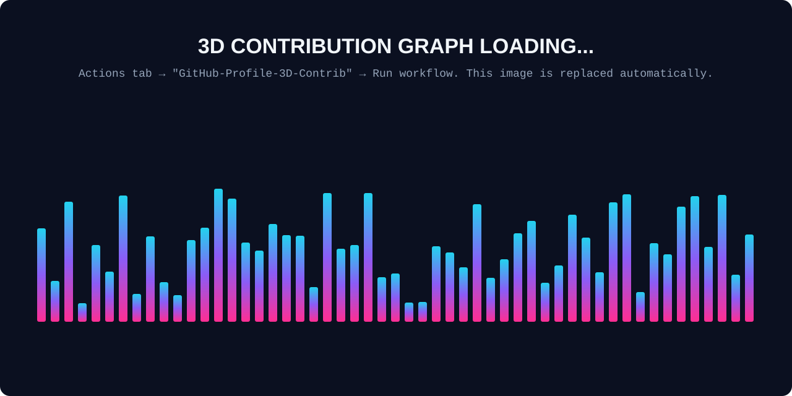

📊 <b>Open the live stat cards</b> (third-party widgets, can be slow)

 

<!-- ===================== ISSUE 08 · TRAINING GROUNDS ===================== -->


<table>
<tr>
<td width="50%" valign="top">

**🏛️ Guru Nanak Institute of Technology** 
B.Tech in Information Technology 
*2025 – 2029* · Kolkata

</td>
<td width="50%" valign="top">

**📚 Dooars International Public School** 
Higher Secondary · Science Stream 
*Physics · Chemistry · Mathematics · Computer Science*

</td>
</tr>
</table>

<!-- ===================== ISSUE 09 · LIGHT THE SIGNAL ===================== -->



**Got an idea, a project, or a hackathon team that needs one more builder?**
 
Light the signal. I'll be there.

 

  

**🧭 CHOOSE YOUR PATH**

🕵️ <b>I'm a recruiter or hiring manager</b>

 

Fastest tour: open **Case Files** (every card links to a live demo), skim **Boss Battles** for how I work under a deadline, then email me. Happy to walk through any project.

📧 [ashishchandraacharjee@gmail.com](mailto:ashishchandraacharjee@gmail.com) · 💼 [LinkedIn](https://www.linkedin.com/in/ashish-chandra-acharjee/) · 🌐 [Portfolio](https://portfolio-updated-rho-three.vercel.app/)

🤝 <b>I'm looking for a hackathon teammate</b>

 

I'm in. Send me the problem statement on [LinkedIn](https://www.linkedin.com/in/ashish-chandra-acharjee/) and we'll figure out the squad. Two events down, Arc 03 is loading.

💻 <b>I'm a fellow developer</b>

 

Star a repo, open an issue, or fork it and send a PR. Feedback on my projects is always welcome.

👉 [Browse all repositories](https://github.com/ashishacharjee?tab=repositories)

 

🎮 <b>Psst... try the Konami code:</b> ↑ ↑ ↓ ↓ ← → ← → B A

 
<b>+30 lives unlocked.</b> 
Bonus: I'm always up for a hackathon. Message me.

 


Made with curiosity, caffeine and code.

