<!--
  ============================================================
   THE DEV-VERSE  ·  Profile README for Ashish Chandra Acharjee
   Custom animated assets live in /assets  ·  Pac-Man graph is
   generated by .github/workflows/pacman.yml
  ============================================================
-->

<div align="center">


<a href="https://github.com/ashishacharjee">
  
</a>

<br/>

<a href="https://github.com/ashishacharjee"></a>
<a href="https://www.linkedin.com/in/ashish-chandra-acharjee/"></a>
<a href="mailto:ashishchandraacharjee@gmail.com"></a>
<a href="https://portfolio-updated-rho-three.vercel.app/"></a>

<br/><br/>


<!-- ===================== ISSUE 01 · ORIGIN STORY ===================== -->

<sub><b>ISSUE #01</b></sub>
<h2>🕷️ ORIGIN STORY</h2>
<i>Every hero has one. Mine started with a bite from the curiosity bug.</i>

</div>

I'm **Ashish Chandra Acharjee**, a B.Tech Information Technology student at **Guru Nanak Institute of Technology, Kolkata**. I learn by building: take an idea, break it into parts, prototype it, ship it, then figure out what I'd do better next time.

So far that loop has produced an emergency-response platform, a healthcare assistant, a food-rescue network and an e-commerce app. Different universes, same habit.

<table>
<tr>
<td width="50%" valign="top">

**⚡ POWERS**

- 💻 Python, C, C++, Java, JavaScript, TypeScript
- 🌐 Frontend and backend development
- 🤖 AI/ML and data-driven applications
- 🔐 Document security and cryptography (SigilChain)

</td>
<td width="50%" valign="top">

**🎯 CURRENT MISSIONS**

- 🔭 Exploring AI/ML and data-driven apps
- 🏗️ Building projects that solve real problems
- 🏆 Chasing the next hackathon
- 🤝 Open to interesting projects and opportunities

</td>
</tr>
</table>

<div align="center">

</div>

<div align="center">


<!-- ===================== ISSUE 02 · UTILITY BELT ===================== -->

<sub><b>ISSUE #02</b></sub>
<h2>🦇 THE UTILITY BELT</h2>
<i>A good gadget for every problem. Always adding new ones.</i>

<br/><br/>

<table>
<tr>
<td align="right" valign="middle"><b>⚔️ WEAPONS OF CHOICE</b><br/><sub>Languages</sub></td>
<td align="left" valign="middle"></td>
</tr>
<tr>
<td align="right" valign="middle"><b>🕸️ WEB-SLINGERS</b><br/><sub>Frontend</sub></td>
<td align="left" valign="middle"></td>
</tr>
<tr>
<td align="right" valign="middle"><b>🏛️ THE BATCAVE</b><br/><sub>Backend and databases</sub></td>
<td align="left" valign="middle"></td>
</tr>
<tr>
<td align="right" valign="middle"><b>🧠 NEURAL NET</b><br/><sub>AI, ML and data</sub></td>
<td align="left" valign="middle">  </td>
</tr>
<tr>
<td align="right" valign="middle"><b>🧰 GADGETS</b><br/><sub>Tools and platforms</sub></td>
<td align="left" valign="middle"> </td>
</tr>
</table>


<!-- ===================== ISSUE 03 · CASE FILES ===================== -->

<sub><b>ISSUE #03</b></sub>
<h2>🗂️ CASE FILES</h2>
<i>Selected missions. Open the live demo or crack open the source.</i>

</div>

<!-- FEATURED CASE -->
<table>
<tr>
<td width="55%" valign="top">

```text
╔═ CASE FILE 001 ════════════════════════╗
║ RakshaLink                             ║
║ A Bat-Signal that knows who to call    ║
╟────────────────────────────────────────╢
║ DOMAIN  Road emergency response        ║
║ POWERS  Crash-triggered alerts         ║
║         Responder matching + console   ║
║         Escalation + offline mode      ║
║ SQUAD   Team InitToWinIt               ║
║ STATUS  ● DEPLOYED                     ║
╚════════════════════════════════════════╝
```

**Not just an SOS button.** A road-emergency platform built to get people the *right* help during accidents, medical emergencies, breakdowns and fuel shortages.

Crash-triggered alerts, responder matching, a dedicated responder console, escalation, and an offline fallback for when the network isn't on your side.

<a href="https://github.com/ashishacharjee/RakshaLink"></a>
<a href="https://rakshalink-theta.vercel.app/"></a>

</td>
<td width="45%" align="center" valign="middle">

<a href="https://rakshalink-theta.vercel.app/"></a>
<br/>
<sub>RakshaLink · live dashboard · click to open</sub>

</td>
</tr>
</table>

<table>
<tr>
<td width="50%" valign="top">

```text
╔═ CASE FILE 002 ════════════════════════╗
║ FoodBridge+                            ║
║ No meal left behind                    ║
╟────────────────────────────────────────╢
║ DOMAIN  Food rescue + ESG analytics    ║
║ STACK   React · Vite · Node · Express  ║
║         Snowflake · Cloudinary         ║
║ POWERS  Real-time NGO claiming         ║
║         Meals & emissions dashboard    ║
║ STATUS  ● DEPLOYED                     ║
╚════════════════════════════════════════╝
```

A B2B platform connecting commercial kitchens with NGOs that can collect surplus food. Kitchens list batches, NGOs claim them in real time, and an impact dashboard tracks meals enabled and emissions prevented.

<a href="https://github.com/ashishacharjee/FoodBridge"></a>
<a href="https://food-bridge-indol.vercel.app/"></a>

</td>
<td width="50%" valign="top">

```text
╔═ CASE FILE 003 ════════════════════════╗
║ IP-Sakti Sahayak                       ║
║ Ancient wisdom, modern guardrails      ║
╟────────────────────────────────────────╢
║ DOMAIN  Ayurveda IP + regulation       ║
║ STACK   Python · FastAPI · RAG         ║
║         AI Agents · Multilingual       ║
║ POWERS  Patents · Trademarks · GI      ║
║         ABS compliance · TK search     ║
║ STATUS  ● DEPLOYED                     ║
╚════════════════════════════════════════╝
```

A multilingual assistant for Ayurveda intellectual-property and regulatory guidance. It pairs retrieval-grounded answers with deterministic rule engines for patents, trademarks, geographical indications, ABS compliance and traditional-knowledge searches.

<a href="https://github.com/ashishacharjee/ipsakti-sahayak"></a>
<a href="https://ipsakti-sahayak-delta.vercel.app/"></a>

</td>
</tr>
<tr>
<td width="50%" valign="top">

```text
╔═ CASE FILE 004 ════════════════════════╗
║ AI Doctor Assistance                   ║
║ Baymax energy, in your browser         ║
╟────────────────────────────────────────╢
║ DOMAIN  Healthcare technology          ║
║ STACK   Next.js · React · TypeScript   ║
║         Tailwind CSS                   ║
║ POWERS  Symptom analysis · Med scan    ║
║         Location-based doctor finder   ║
║         Voice input · Multilingual     ║
║ STATUS  ● DEPLOYED                     ║
╚════════════════════════════════════════╝
```

An AI healthcare platform with symptom analysis, medicine scanning and location-based doctor recommendations, plus voice input, multilingual support and a mobile-friendly interface.

<a href="https://github.com/ashishacharjee/AI-Doctor-Assistance"></a>
<a href="https://ai-doctor-assistance-s2ac.vercel.app/"></a>

</td>
<td width="50%" valign="top">

```text
╔═ CASE FILE 005 ════════════════════════╗
║ Velvetry E-Commerce                    ║
║ Browse. Cart. Checkout. Conquer.       ║
╟────────────────────────────────────────╢
║ DOMAIN  E-commerce application         ║
║ STACK   Next.js 14 · React             ║
║         TypeScript · CSS               ║
║ POWERS  Catalogue · Cart · Checkout    ║
║         Order tracking + admin panel   ║
║ STATUS  ● OPEN SOURCE                  ║
╚════════════════════════════════════════╝
```

A modern shopping app with a product catalogue, product details, cart management, checkout, order tracking and an admin dashboard.

<a href="https://github.com/ashishacharjee/Velvetry-ECommerce-Website"></a>

</td>
</tr>
</table>

<div align="center">

**🎲 SIDE QUESTS**

<table>
<tr><th>Quest</th><th>Loot</th></tr>
<tr><td>Personal Portfolio</td><td>My website and project showcase</td></tr>
<tr><td>Library Management</td><td>Books, members and borrowing</td></tr>
<tr><td>Food Ordering System</td><td>Terminal-based ordering and billing</td></tr>
<tr><td>Hangman Game</td><td>Python take on the classic</td></tr>
</table>

<a href="https://github.com/ashishacharjee?tab=repositories"></a>


<!-- ===================== ISSUE 04 · BOSS BATTLES ===================== -->

<sub><b>ISSUE #04</b></sub>
<h2>⚔️ BOSS BATTLES</h2>
<i>Two arcs. Two very different challenges. One squad.</i>

</div>

```text
 ARC 01   Recursive Hackathon 2026   [████████████]  COMPLETED   08 OCT 2026
 ARC 02   HackInverse 1.0            [████████████]  COMPLETED   11 OCT 2026
 ARC 03   ? ? ?                      [░░░░░░░░░░░░]  LOADING...
```

<table>
<tr>
<td width="22%" align="center" valign="middle">


<br/><br/>
<sub><b>THE FIRST FIGHT</b></sub>

</td>
<td width="78%" valign="top">

### Recursive Hackathon 2026
**Team InitToWinIt** · GNIT Kolkata ACM Student Chapter

My first hackathon. Eight hours to shape an idea, build the prototype, polish the flow and pitch it. We built **RakshaLink**, the road-emergency platform that connects people in distress with the right responders.

`Emergency Response` `Responder Workflow` `Crash Alerts` `Web Development`

<a href="https://github.com/ashishacharjee/RakshaLink"></a>
<a href="https://rakshalink-theta.vercel.app/"></a>

</td>
</tr>
<tr>
<td width="22%" align="center" valign="middle">


<br/><br/>
<sub><b>THE SEQUEL</b></sub>

</td>
<td width="78%" valign="top">

### HackInverse 1.0
**Project: SigilChain** · *every leak leaves a fingerprint*

Three days later, another build. SigilChain tackles document-leak attribution: recipient-specific watermarking that helps trace a leaked copy back to the copy issued to one particular recipient, backed by cryptographic techniques for protecting authenticity and auditability.

`Python` `Document Security` `Watermarking` `Post-Quantum Cryptography`

<!-- TODO: add a SigilChain repository badge here once the repo is public -->
<a href="https://hackinverse-s1.devfolio.co/"></a>

</td>
</tr>
</table>

<div align="center">


<!-- ===================== ISSUE 05 · ACHIEVEMENTS ===================== -->

<sub><b>ISSUE #05</b></sub>
<h2>🏆 ACHIEVEMENTS UNLOCKED</h2>
<i>Progress, tracked honestly. Locked quests are the fun part.</i>

</div>

<table>
<tr>
<td width="55%" valign="top">

| | Achievement | Unlocked |
|:-:|:--|:--|
| 🩸 | **First Blood**: first hackathon, prototype built in 8 hours | 08 Oct 2026 |
| ⚡ | **Combo**: second hackathon only three days later | 11 Oct 2026 |
| 🚀 | **Shipped**: four projects with live demos | ongoing |
| 🧩 | **Multi-Class**: web, AI/ML and security in one portfolio | ongoing |
| 🤝 | **Team Player**: collaborative builds, two events | ongoing |

</td>
<td width="45%" valign="top">

**📜 QUEST LOG**

- [x] Build and ship a full-stack project
- [x] Join my first hackathon
- [x] Build an AI assistant with RAG
- [x] Prototype a document-security idea
- [ ] Win a hackathon 🏆
- [ ] Land an internship
- [ ] Merge a pull request into open source
- [ ] Build something real people use daily

</td>
</tr>
</table>

<div align="center">


<!-- ===================== ISSUE 06 · WATCHTOWER ===================== -->

<sub><b>ISSUE #06</b></sub>
<h2>📡 THE WATCHTOWER</h2>
<i>Live intel on the work, the commits and the streak.</i>

<br/>


<br/><br/>

**🟡 CONTRIBUTION MAZE**
<br/>
<sub>Pac-Man is eating my commit graph. Make more commits, give him more to chase.</sub>
<br/>

<picture>
  <source media="(prefers-color-scheme: dark)" srcset="https://raw.githubusercontent.com/ashishacharjee/ashishacharjee/output/pacman-contribution-graph-dark.svg">
  <source media="(prefers-color-scheme: light)" srcset="https://raw.githubusercontent.com/ashishacharjee/ashishacharjee/output/pacman-contribution-graph.svg">
  
</picture>


<!-- ===================== ISSUE 07 · TRAINING GROUNDS ===================== -->

<sub><b>ISSUE #07</b></sub>
<h2>🎓 TRAINING GROUNDS</h2>

</div>

<table>
<tr>
<td width="50%" valign="top">

**🏛️ Guru Nanak Institute of Technology**
B.Tech in Information Technology
*2025 – 2029* · Kolkata

</td>
<td width="50%" valign="top">

**📚 Dooars International Public School**
Higher Secondary · Science Stream
*Physics · Chemistry · Mathematics · Computer Science*

</td>
</tr>
</table>

<div align="center">

<!-- ===================== ISSUE 08 · LIGHT THE SIGNAL ===================== -->

<sub><b>ISSUE #08</b></sub>
<h2>📡 LIGHT THE SIGNAL</h2>


**Got an idea, a project, or a hackathon team that needs one more builder?**
<br/>
Light the signal. I'll be there.

<br/>

<a href="https://github.com/ashishacharjee"></a>
<a href="https://www.linkedin.com/in/ashish-chandra-acharjee/"></a>
<a href="mailto:ashishchandraacharjee@gmail.com"></a>
<a href="https://portfolio-updated-rho-three.vercel.app/"></a>

<br/><br/>

<details>
<summary>🎮 <b>Psst... try the Konami code:</b> ↑ ↑ ↓ ↓ ← → ← → B A</summary>
<br/>
<b>+30 lives unlocked.</b><br/>
Bonus: I'm always up for a hackathon. Message me.
</details>

<br/>


<sub>Made with curiosity, caffeine and code.</sub>
<br/>
<sub><i>Pop-culture references are fan tributes. All characters and trademarks belong to their respective owners.</i></sub>


</div>
